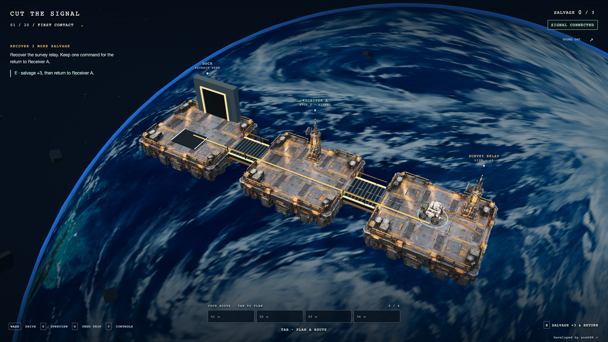

# Cut the Signal

A 3D orbital salvage puzzle game by [aceDZN](https://acedzn.dev).

Drive a salvage drone across a wreck above a blue planet. The relays are valuable cargo—and your control network. Dismantle them in the right order, and trust your uploaded route when the signal disappears.



- **20 authored levels** in four chapters, from a first safe return to a ten-relay, three-slot finale.
- Continuous WASD driving, click-to-travel, sliding guardrails and a follow/orbit camera.
- One-action salvage with a visible safe return, plus custom route planning for dark crossings.
- Repeated trip undo, progressive hints, local progress/resume, touch controls and reduced motion.
- Three textured 3D models, local sound and a rendered planet. Everything needed to play is bundled.

## Run locally

Use **Node.js 24** and a browser with WebGL 2. Hardware acceleration is recommended.

```sh
git clone https://github.com/AceDZN/cut-the-signal.git
cd cut-the-signal
npm ci
npm run dev
```

Open [localhost:5173](http://127.0.0.1:5173/).

```sh
npm test               # 104 rule, campaign, navigation and movement checks
npm run format:check
npm run build          # TypeScript + production Vite build
npm run preview        # built game at http://127.0.0.1:4173/
```

The game has no backend, environment variables, API keys, runtime AI calls or external asset requests. Progress is stored in this browser.

## First run

Enter the wreck. Drive with WASD or click a live deck to travel there. A ring identifies your drone. When you reach Survey Relay, the highlighted route shows where it will return. Press **E** to salvage and return to Receiver A automatically. Press E at A to salvage it and return to Dock. Press E at Dock to bank the cargo.

For dark crossings or a custom route, **Tab** opens planning. Each move, cut and extraction occupies one slot. Destinations are relative to the last planned stop; numbered world labels and the route line show the journey. The safety check explains an incomplete offline return before you can upload it. Quick salvage also explains which required cargo still depends on the current receiver, helping you preserve it until that job is done. **Add a safe return** fills the remaining legal return when it fits; otherwise undo a stop or preserve a different receiver.

Amber cables carry signal. Catwalks carry the drone. They are separate connections. One-way catwalks have arrows. Cut relays leave traversable floors. Offline, your already-uploaded route keeps running. Direct driving stops before entering an offline deck; plan that crossing with Tab.

**U / Undo trip** restores the drone, relay network and cargo before a trip, including while autopilot is offline. Press again to go farther back (up to 80 trips in the current attempt). R restarts the whole wreck. Driving exits overview and clears an unfinished closed draft, so neither silently freezes the drone. Help and the mission menu visibly suspend manual driving.

## Controls

| Input | Action |
| --- | --- |
| WASD / arrows, programmer closed | Continuous driving relative to camera |
| Click a live deck, programmer closed | Travel through connected receivers within the buffer limit |
| Tab | Open/close the autopilot programmer |
| Click a deck / move button, programmer open | Append one legal move |
| S / X, programmer open | Append Cut / Extract |
| Arrow keys, programmer open | Append a move in diagram direction |
| E / contextual button | Salvage + safe return; bank at Dock; run a safe draft |
| U / Undo trip | Restore the previous trip; press again to go back farther |
| Enter | Upload & run |
| Space | Step; continues automatically while offline |
| P | Pause at a connected command boundary |
| Backspace, programmer open | Undo draft command |
| Right mouse drag | Orbit camera |
| Wheel | Zoom camera |
| V | Toggle whole-wreck overview |
| R | Restart attempt |
| M | Toggle sound |
| F / Escape | Fullscreen / exit or close overlay |

The programmer opens on demand. HTML controls and touch driving arrows are available on narrow screens. Reduced motion removes particles and UI transitions while retaining command timing. Sounds are locally synthesized and start muted. Guarded local storage keeps best salvage, sound preference and the next selected wreck.

## Twenty wrecks

The campaign has four five-level chapters: Learn the Job, Read the Network, Cross the Dark, and Dismantle the Wreck. Early stages teach a safe return, branches and one-way paths. Later stages combine dark crossings, alternate feeds, dependent checkpoints and three-slot buffers. The last wreck requires all ten relays. The chapter menu shows completion marks; every level is selectable and replayable. Finishing offers the next wreck, and reopening resumes the selected/next wreck.

[design/CAMPAIGN.md](design/CAMPAIGN.md) lists all 20 stages, values, teaching goals and progression. Every level has a checked full-value witness and an independently searched quota/perfect solution. The suggested-return helper uses graph search, never the witness solutions. Its assistance makes basic salvage approachable while checkpoint order and complete dark crossings remain player decisions. Difficulty is designed; human playtesting has not yet calibrated the curve.

The footer and controls/help panel credit [aceDZN](https://acedzn.dev) as the developer.

## Deploy on Vercel

Import **AceDZN/cut-the-signal** into the Vercel team/project you want to use. The repository includes `vercel.json` and pins Node.js 24 in `package.json`.

| Setting | Value |
| --- | --- |
| Root directory | Repository root (`.`) |
| Framework preset | Vite |
| Install command | `npm ci` |
| Build command | `npm run build` |
| Output directory | `dist` |
| Node.js | `24.x` |
| Environment variables | None |

The build includes `public/assets/` and the favicon. It is a static client application and needs no server functions. Models and textures use root-relative URLs, so serve the game at the deployment's root path.

See the official [Vite deployment guide](https://vercel.com/docs/frameworks/frontend/vite), [project configuration](https://vercel.com/docs/project-configuration/vercel-json), and [Node.js versions](https://vercel.com/docs/functions/runtimes/node-js/node-js-versions).

## Art and design

The models were generated with Tripo Studio from generated image references, then optimized locally. The planet uses a generated albedo texture on a sphere. Generated target frames are design references, not screenshots of the implementation. The image above is captured from the running game.

[ASSETS.md](ASSETS.md) records provenance. [design/PROMPTS.md](design/PROMPTS.md) contains the image prompts; [design/ART_DIRECTION.md](design/ART_DIRECTION.md) describes the composition. To review target and actual frames locally, run the capture commands below and open `/design/compare.html` on the dev server. The comparison tool is for local design review, separate from the production game.

## Browser verification

Start the dev server in another terminal, then:

```sh
npx playwright install chromium
npm run test:browser
npm run capture:reference
```

For a built production preview:

```sh
npm run build
npm run preview
# In another terminal:
GAME_URL=http://127.0.0.1:4173 GAME_ARTIFACT_NAME=production npm run test:browser
```

`SMOKE_ONLY=1 npm run test:browser` checks the first/final levels and the control regressions. The full suite replays all 20 perfect solutions and blocks unsafe returns in every wreck. Tests use ordinary controls plus `window.advanceTime(ms)` for deterministic time; `window.render_game_to_text()` exposes readable runtime state. Screenshots and reports go to the ignored `output/` directory.

[PLAYTEST.md](PLAYTEST.md) records verification and known limits.

## Code map

- `src/main.ts`: interface, input, timing, audio and trip recovery.
- `src/world.ts`: Three.js rendering, models, camera, labels and route preview.
- `src/game/physical.ts`: floor bounds, equipment placement, sliding collision and receiver handoff.
- `src/game/navigation.ts`: legal route search, quick salvage and upload safety.
- `src/game/campaign.ts` and `levels.ts`: twenty authored wrecks and campaign order.
- `src/game/simulate.ts`: pure signal graph and command interpreter.

Created by [aceDZN](https://acedzn.dev).
